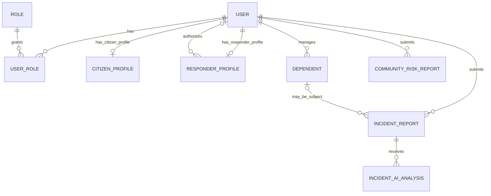
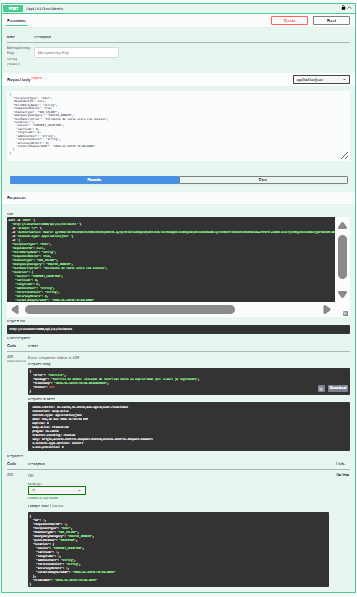
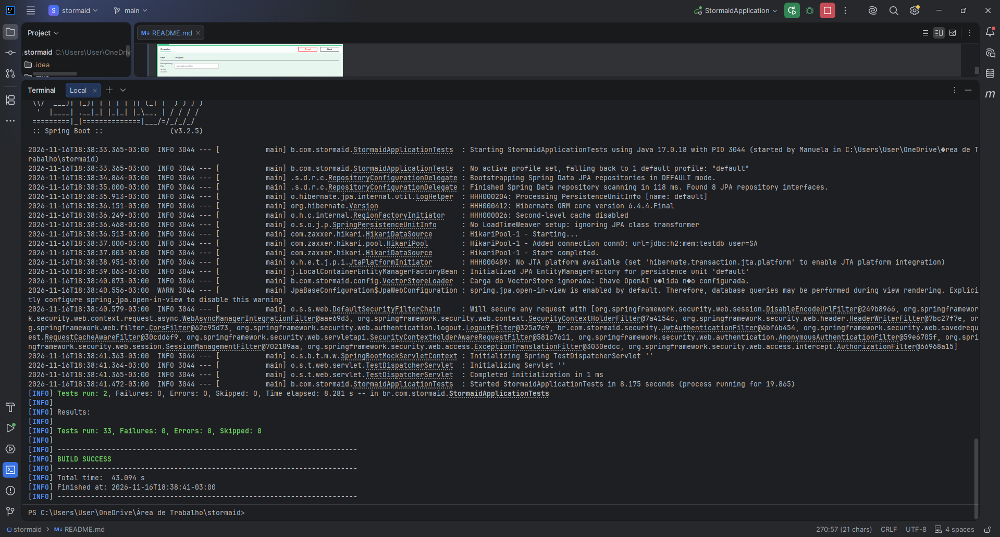

# 🚨 StormAid API

O **StormAid** é uma plataforma inteligente de gestão de emergências, zeladoria comunitária e resposta a catástrofes. A API integra cidadãos, dependentes e socorristas/reguladores institucionais através de uma arquitetura robusta em Spring Boot com segurança JWT, persistência em Oracle Database, mensageria assíncrona com RabbitMQ e inteligência artificial com Spring AI (RAG).

---

# 🚀 Swagger UI & Consoles

Acesse a documentação interativa e realize testes diretamente pelo navegador:

```bash
https://stormaid-java-gs.onrender.com/swagger-ui/index.html
```
```bash
http://localhost:8080/swagger-ui/index.html
```
```bash
http://localhost:8080
```
---

# 🔗 Link YouTube (Pitch)

```bash
LINK YOUTUBE
```
---

## 👥 Integrantes do Grupo

<table>
  <tr>
    <td width="130">
      
    </td>
    <td>
      <b>Moisés Barsoti Andrade de Oliveira</b><br/>
      <b>RM:</b> 565049 &nbsp;&nbsp;|&nbsp;&nbsp;<b>Turma:</b> 2TDSPO - FIAP <br/>
    </td>
  </tr>

  <tr>
    <td width="130">
      
    </td>
    <td>
      <b>Sofia Siqueira Fontes</b><br/>
      <b>RM:</b> 563829 &nbsp;&nbsp;|&nbsp;&nbsp;<b>Turma:</b> 2TDSPG - FIAP <br/>
    </td>
  </tr>

  <tr>
    <td width="130">
      
    </td>
    <td>
      <b>Manuela de Lacerda Soares</b><br/>
      <b>RM:</b> 564887 &nbsp;&nbsp;|&nbsp;&nbsp;<b>Turma:</b> 2TDSPG - FIAP <br/>
    </td>
  </tr>
</table>

---

## ⚙️ Tecnologias e Configurações
### Tecnologias Utilizadas
- **Java 17 / 21** & **Spring Boot 3.2.x**
- **Spring AI (Integração com LLM e RAG para análise de incidentes)**
- **Spring Security** com **JWT (JSON Web Token)**
- **Oracle Database** (Ambiente Principal) & **H2 Database** (Ambiente de Testes)
- **Flyway Migration** (Gerenciamento de Schemas SQL)
- **RabbitMQ** (Mensageria para criação e processamento assíncrono de incidentes)
- **JUnit 5 / MockMvc** (Testes de Integração)

---

## 🤖 Declaração de Uso de Inteligência Artificial (Spring AI & RAG)

- **Ferramentas Utilizadas**: Spring AI integrado com modelos OpenAI (LLM e Embeddings) e recuperação de contexto vetorial (RAG).
- **Fluxo Real de Spring AI / RAG**: Quando uma ocorrência é criada, o evento é publicado no RabbitMQ (`incident.ai.queue`). O consumidor aciona o `RagAnalysisService`, que consulta a base de conhecimento do sistema para recuperar contexto relevante e gera uma análise automatizada de triagem e risco persistida na ocorrência.
- **Transcrição de Áudio (Simulada vs. Real)**: O sistema suporta rotinas assíncronas para processamento de áudios de emergência utilizando atualmente uma **transcrição simulada** (baseada em metadados/chaves de teste pré-definidos para demonstração académica), diferindo de uma **transcrição real** via APIs de Speech-to-Text (como Whisper) em tempo real.
- **Limitações**: A análise depende da disponibilidade e quota da API externa da OpenAI e do contexto previamente indexado na base de conhecimento; em caso de falha na API externa, o sistema aplica fallback sem bloquear o registo da ocorrência.

---

## 📊 Arquitetura e Modelo de Dados (Diagrama ER)

Abaixo está representado o diagrama de entidades e relacionamentos (ER) da base de dados do StormAid, mapeando utilizadores, perfis, dependentes, ocorrências e análises de IA:


---

## 🔐 Roles e Perfis de Acesso (Os Quatro Perfis)

O sistema utiliza quatro perfis (roles) de autorização distintos:

1. `CITIZEN`: Cidadão comum com permissão para gerenciar seu próprio perfil, cadastrar dependentes, registrar ocorrências de incidentes e relatos de riscos comunitários.
2. `RESPONDER`: Socorrista institucional responsável pelo atendimento de emergências no local. O **cadastro institucional** do socorrista é submetido no sistema e permanece pendente de validação até ser analisado e aprovado por um `REGULATOR` através do fluxo interno de credenciamento.
3. `REGULATOR`: Agente regulador encarregado da triagem, verificação de credenciais institucionais, aprovação/autorização de socorristas (`RESPONDER`) e gestão estratégica de equipes.
4. `ADMIN`: Administrador global do sistema, com permissão para gestão avançada de utilizadores, controlo de acessos e auditoria administrativa.

---

## 🛠️ Configuração de Banco de Dados (Oracle & Flyway) e JWT

### 1. Migrações de Banco de Dados (Flyway)
As migrações SQL são executadas automaticamente na inicialização da aplicação em ambiente de produção/desenvolvimento Oracle:
- `V1__create_stormaid_schema.sql`: Criação das tabelas base (`TB_STORMAID_USER`, `TB_STORMAID_USER_ROLE`, etc.).
- `V2__seed_initial_data.sql`: Carga inicial de permissões e perfis padronizados.

### 2. Variáveis de Ambiente
Configure as seguintes variáveis no seu ambiente ou no `application.properties`:

```properties
# Base de Dados Oracle
ORACLE_URL=jdbc:oracle:thin:@oracle.fiap.com.br:1521:ORCL
ORACLE_USER=seu_usuario_rm
ORACLE_PASSWORD=sua_senha_oracle

# Mensageria RabbitMQ
RABBITMQ_HOST=127.0.0.1
RABBITMQ_PORT=5672
RABBITMQ_USERNAME=stormaid
RABBITMQ_PASSWORD=sua_senha_rabbitmq
RABBITMQ_VIRTUAL_HOST=/

# Servidor & Segurança JWT
PORT=8080
JWT_SECRET=sua_chave_jwt_super_segura_aqui

# Inteligência Artificial (Spring AI / OpenAI)
API_KEY=sua_chave_api_openai_aqui

# E-mail (SMTP)
MAIL_HOST=smtp.gmail.com
MAIL_PORT=587
MAIL_USERNAME=seu_email@exemplo.com
MAIL_PASSWORD=sua_senha_ou_app_password
```
---

## 📬 Mensageria Assíncrona (RabbitMQ)

A API do StormAid publica eventos assíncronos críticos:
- Fila de Incidentes: incident.created.v1
- Fila de IA (RAG): incident.ai.queue
- Exchange: stormaid.incidents
---

## 🧪 Execução de Testes Automatizados

Os testes de integração utilizam uma configuração isolada em memória com banco H2 (src/test/resources/application.properties).

### Como executar os testes via Maven:

**Windows (PowerShell):**
```powershell
.\mvnw clean test
```

**Linux / macOS:**
```bash
./mvnw clean test
```

> **Status da Suíte de Testes**: `BUILD SUCCESS` (Testes de inicialização de contexto Spring Boot e bloqueio de acesso sem token JWT validados com status HTTP `403 Forbidden`).

---

## 💻 Como Executar a Aplicação

**Windows:**
```powershell
.\mvnw.cmd spring-boot:run
```

**Linux / macOS:**
```bash
./mvnw spring-boot:run
```
---

### Execução via Docker e Docker Compose

1. **Subir os serviços de infraestrutura (RabbitMQ e Oracle):**
   ```bash
   docker-compose up -d
   ```

2 **Rodar build Docker:**
   ```bash
   docker build -t stormaid-api .
   ```
---

## 🔑 Contas de Teste Pré-Configuradas

Para facilitar a avaliação, a aplicação inicializa automaticamente contas de teste para cada perfil de acesso do sistema:

| Perfil | E-mail de Acesso | Senha | Descrição |
| :--- | :--- | :--- | :--- |
| **CITIZEN** | `cidadao@stormaid.example` | `SenhaForte!2026` | Cidadão comum para abertura de incidentes e dependentes |
| **RESPONDER** | `carlos.socorrista@stormaid.example` | `SenhaForte!2026` | Socorrista institucional de campo |
| **REGULATOR** | `regulator@stormaid.example` | `SenhaForte!2026` | Agente regulador e gestor de credenciamento |
| **ADMIN** | `admin@stormaid.example` | `SenhaForte!2026` | Administrador global do sistema |

---
## 📌 Endpoints da API

### 🔐 1. Autenticação (`/auth`)

| Método | Endpoint | Descrição | Acesso |
|--------|----------|-----------|--------|
| `POST` | `/auth/login` | Realiza o login na aplicação e retorna o token JWT | Público |
| `POST` | `/auth/register` | Registro de novos usuários com role `CITIZEN` | Público |

---

### 👤 2. Perfil do Cidadão (`/api/v1/citizens`)

| Método | Endpoint | Descrição | Acesso |
|--------|----------|-----------|--------|
| `GET` | `/api/v1/citizens/me/profile` | Retorna os dados do perfil do cidadão autenticado | `CITIZEN` |
| `PUT` | `/api/v1/citizens/me/profile` | Atualiza o perfil do cidadão autenticado | `CITIZEN` |

---

### 👨‍👩‍👧 3. Dependentes (`/api/v1/dependents`)

| Método | Endpoint | Descrição | Acesso |
|--------|----------|-----------|--------|
| `GET` | `/api/v1/dependents` | Lista os dependentes associados ao cidadão autenticado | `CITIZEN` |
| `POST` | `/api/v1/dependents` | Cadastra um novo dependente para o cidadão | `CITIZEN` |
| `GET` | `/api/v1/dependents/{id}` | Busca os detalhes de um dependente por ID | `CITIZEN` |
| `PUT` | `/api/v1/dependents/{id}` | Atualiza os dados de um dependente | `CITIZEN` |
| `DELETE` | `/api/v1/dependents/{id}` | Remove o registro de um dependente | `CITIZEN` |

---

### 🚨 4. Ocorrências de Incidentes (`/api/v1/incidents`)

| Método | Endpoint | Descrição | Acesso |
|--------|----------|-----------|--------|
| `GET` | `/api/v1/incidents` | Lista todas as ocorrências do cidadão | `CITIZEN` |
| `POST` | `/api/v1/incidents` | Registra nova ocorrência (dispara evento `incident.created.v1`) | `CITIZEN` |
| `GET` | `/api/v1/incidents/{id}` | Consulta detalhes de uma ocorrência específica | `CITIZEN`, `RESPONDER`, `REGULATOR` |

---

### 🛡️ 5. Relatos de Risco Comunitário (`/api/v1/community-risks`)

| Método | Endpoint | Descrição | Acesso |
|--------|----------|-----------|--------|
| `GET` | `/api/v1/community-risks` | Lista os relatos de risco de zeladoria urbana | `CITIZEN`, `REGULATOR` |
| `POST` | `/api/v1/community-risks` | Cadastra um novo relato de risco comunitário | `CITIZEN` |
| `GET` | `/api/v1/community-risks/{id}` | Detalhes de um relato de risco específico | `CITIZEN`, `REGULATOR` |
| `PUT` | `/api/v1/community-risks/{id}` | Atualiza as informações de um relato de risco | `CITIZEN` |
| `DELETE` | `/api/v1/community-risks/{id}` | Remove um relato de risco cadastrado | `CITIZEN`, `REGULATOR` |

---

### 🚑 6. Perfil do Socorrista (`/api/v1/responders`)

| Método | Endpoint | Descrição | Acesso |
|--------|----------|-----------|--------|
| `GET` | `/api/v1/responders/me/profile` | Retorna o perfil do socorrista autenticado | `RESPONDER` |
| `GET` | `/api/v1/internal/responders` | Lista socorristas cadastrados | `REGULATOR` |
| `GET` | `/api/v1/internal/responders/{id}` | Busca socorrista por ID | `REGULATOR` |
| `PATCH` | `/api/v1/internal/responders/{id}/authorization` | Atualiza status de verificação/credenciamento | `REGULATOR` |
| `GET` | `/api/v1/internal/{userId}/eligibility` | Consulta elegibilidade institucional do socorrista | `REGULATOR`, `ADMIN` |

---
### ⚙️ 7. Administração do Sistema (`/api/v1/admin`)

| Método | Endpoint | Descrição | Acesso |
|--------|----------|-----------|--------|
| `GET` | `/api/v1/admin/users` | Lista todos os utilizadores cadastrados no sistema | `ADMIN` |
| `DELETE` | `/api/v1/admin/users/{id}` | Remove ou desativa um utilizador | `ADMIN` |
| `GET` | `/api/v1/admin/audit-logs` | Consulta logs administrativos e de auditoria | `ADMIN` |
---

## 📸 Evidências e Testes da Aplicação 

Esta secção documenta as evidências de execução, testes funcionais, validação de regras de negócio e a robustez de segurança implementada na API do StormAid.

### 1. Documentação Interativa (Swagger UI)
Abaixo está a interface geral do Swagger UI a expor todos os controladores da API (autenticação, incidentes, dependentes, perfis e relatórios comunitários):
<p align="center">
  
</p>

### 2. Testes de Regras de Negócio e Validação de Exceções (`400 Bad Request`)
O endpoint de registo de incidentes valida rigorosamente os dados enviados no payload (como a existência de dependentes e parâmetros obrigatórios), retornando um erro limpo de Bad Request quando há inconsistências de negócio, antes de prosseguir com o fluxo de mensageria e IA:
<p align="center">
  
</p>

### 3. Testes de Sucesso e Persistência do Incidente (`200 OK`)
Após a validação correta dos parâmetros e do envio com o token de autenticação, o endpoint `POST /api/v1/incidents` processa com sucesso o pedido, persistindo o incidente na base de dados e acionando o ecossistema assíncrono:
<p align="center">
  
</p>

### 4. Suíte de Testes Automatizados
* **Ferramenta**: JUnit 5 / MockMvc (Testes de integração com H2 em memória).
* **Status da Execução**: `BUILD SUCCESS` (Garante que a inicialização do contexto Spring Boot, as migrações e o bloqueio de acessos não autorizados por JWT funcionam perfeitamente).
<p align="center">
  
</p>

