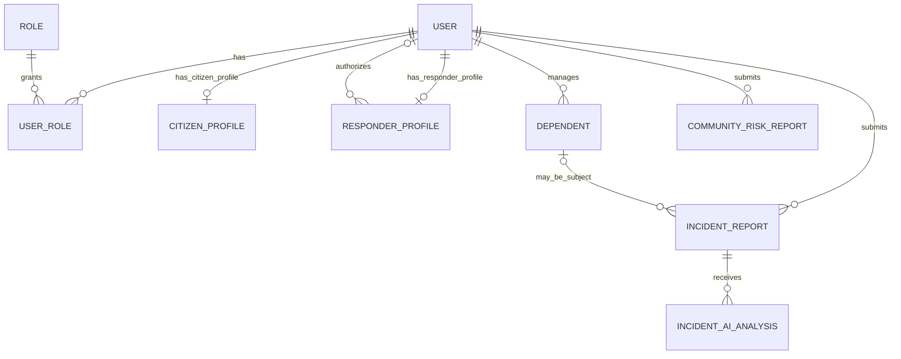
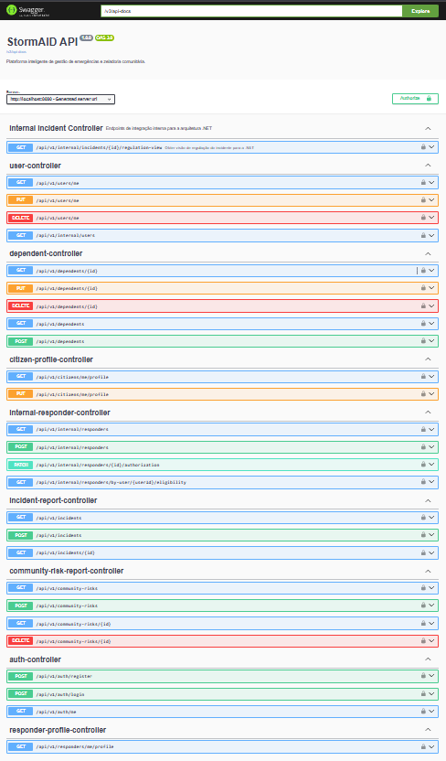
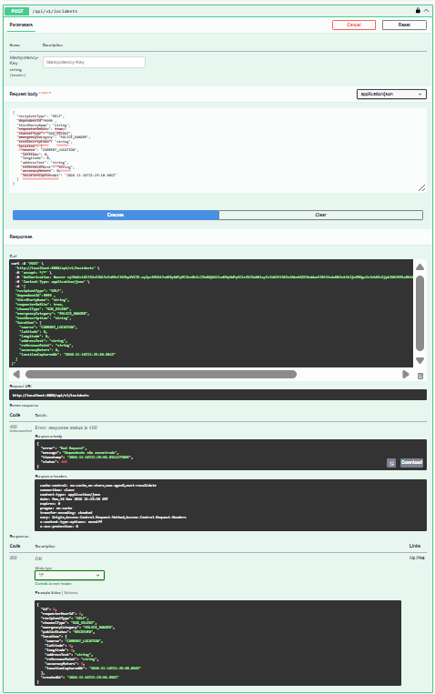

# 🚨 StormAid API

O **StormAid** é uma plataforma inteligente de gestão de emergências, zeladoria comunitária e resposta a catástrofes. A API integra cidadãos, dependentes e socorristas/reguladores institucionais através de uma arquitetura robusta em Spring Boot com segurança JWT, persistência em Oracle Database, mensageria assíncrona com RabbitMQ e inteligência artificial com Spring AI (RAG).

---

# 🚀 Swagger UI & Consoles

Acesse a documentação interativa e realize testes diretamente pelo navegador:

```bash
LINK RENDER
```
```bash
http://localhost:8080/swagger-ui/index.html
```
```bash
http://localhost:8080
```
---

# 🔗 Link YouTube (Pitch)

```bash
LINK YOUTUBE
```
---

## 👥 Integrantes do Grupo

<table>
  <tr>
    <td width="130">
      
    </td>
    <td>
      <b>Moisés Barsoti Andrade de Oliveira</b><br/>
      <b>RM:</b> 565049 &nbsp;&nbsp;|&nbsp;&nbsp;<b>Turma:</b> 2TDSPO - FIAP <br/>
    </td>
  </tr>

  <tr>
    <td width="130">
      
    </td>
    <td>
      <b>Sofia Siqueira Fontes</b><br/>
      <b>RM:</b> 563829 &nbsp;&nbsp;|&nbsp;&nbsp;<b>Turma:</b> 2TDSPG - FIAP <br/>
    </td>
  </tr>

  <tr>
    <td width="130">
      
    </td>
    <td>
      <b>Manuela de Lacerda Soares</b><br/>
      <b>RM:</b> 564887 &nbsp;&nbsp;|&nbsp;&nbsp;<b>Turma:</b> 2TDSPG - FIAP <br/>
    </td>
  </tr>
</table>

---

## ⚙️ Tecnologias e Configurações
### Tecnologias Utilizadas
- **Java 17 / 21** & **Spring Boot 3.2.x**
- **Spring AI (Integração com LLM e RAG para análise de incidentes)**
- **Spring Security** com **JWT (JSON Web Token)**
- **Oracle Database** (Ambiente Principal) & **H2 Database** (Ambiente de Testes)
- **Flyway Migration** (Gerenciamento de Schemas SQL)
- **RabbitMQ** (Mensageria para criação e processamento assíncrono de incidentes)
- **JUnit 5 / MockMvc** (Testes de Integração)

---

## 🤖 Declaração de Uso de Inteligência Artificial (Spring AI & RAG)

- O StormAid utiliza componentes de Spring AI para auxiliar na triagem automatizada e análise contextual de ocorrências:
- RagAnalysisService: Realiza a recuperação de contexto e análise inteligente dos incidentes registados.
- Transcrição de Áudio (Simulada): O sistema suporta rotinas assíncronas para processamento de áudios de emergência (com transcrição simulada baseada em chaves de armazenamento para fins de demonstração académica).
- Mensageria com IA: Os eventos de criação de incidentes são encaminhados via RabbitMQ (incident.ai.queue) para processamento assíncrono por IA, garantindo alta disponibilidade e desacoplamento síncrono.

---

## 📊 Arquitetura e Modelo de Dados (Diagrama ER)

Abaixo está representado o diagrama de entidades e relacionamentos (ER) da base de dados do StormAid, mapeando utilizadores, perfis, dependentes, ocorrências e análises de IA:


---

## 🔐 Roles e Perfis de Acesso

O sistema utiliza três perfis (roles) de autorização bem definidos:

1. `CITIZEN`: Cidadão comum com permissão para gerenciar seu próprio perfil, cadastrar dependentes, registrar ocorrências de incidentes e relatos de riscos comunitários.
2. `RESPONDER`: Socorrista institucional responsável pelo atendimento de emergências no local das ocorrências.
3. `REGULATOR`: Agente regulador encarregado da triagem, verificação de credenciais e gestão estratégica de equipes de resposta.

---

## 🛠️ Configuração de Banco de Dados (Oracle & Flyway) e JWT

### 1. Migrações de Banco de Dados (Flyway)
As migrações SQL são executadas automaticamente na inicialização da aplicação em ambiente de produção/desenvolvimento Oracle:
- `V1__create_stormaid_schema.sql`: Criação das tabelas base (`TB_STORMAID_USER`, `TB_STORMAID_USER_ROLE`, etc.).
- `V2__seed_initial_data.sql`: Carga inicial de permissões e perfis padronizados.

### 2. Variáveis de Ambiente
Configure as seguintes variáveis no seu ambiente ou no `application.properties`:

```properties
# Base de Dados Oracle
spring.datasource.url=jdbc:oracle:thin:@//localhost:1521/XE
spring.datasource.username=seu_usuario
spring.datasource.password=sua_senha
spring.jpa.hibernate.ddl-auto=validate
spring.flyway.enabled=true

# Segurança JWT
api.security.token.secret=${JWT_SECRET:sua_chave_secreta_jwt}

# Mensageria RabbitMQ
spring.rabbitmq.host=${RABBITMQ_HOST:localhost}
spring.rabbitmq.port=${RABBITMQ_PORT:5672}
spring.rabbitmq.username=${RABBITMQ_USER:guest}
spring.rabbitmq.password=${RABBITMQ_PASS:guest}

# Configuração Spring AI / OpenAI (se aplicável)
spring.ai.openai.api-key=${OPENAI_API_KEY:sua_chave_ai}
```
---

## 📬 Mensageria Assíncrona (RabbitMQ)

A API do StormAid publica eventos assíncronos críticos:
- Fila de Incidentes: incident.created.v1
- Fila de IA (RAG): incident.ai.queue
- Exchange: stormaid.incidents
---

## 🧪 Execução de Testes Automatizados

Os testes de integração utilizam uma configuração isolada em memória com banco H2 (src/test/resources/application.properties).

### Como executar os testes via Maven:

**Windows (PowerShell):**
```powershell
.\mvnw clean test
```

**Linux / macOS:**
```bash
./mvnw clean test
```

> **Status da Suíte de Testes**: `BUILD SUCCESS` (Testes de inicialização de contexto Spring Boot e bloqueio de acesso sem token JWT validados com status HTTP `403 Forbidden`).

---

## 💻 Como Executar a Aplicação

**Windows:**
```powershell
.\mvnw.cmd spring-boot:run
```

**Linux / macOS:**
```bash
./mvnw spring-boot:run
```

---

## 📌 Endpoints da API

### 🔐 1. Autenticação (`/auth`)

| Método | Endpoint | Descrição | Acesso |
|--------|----------|-----------|--------|
| `POST` | `/auth/login` | Realiza o login na aplicação e retorna o token JWT | Público |
| `POST` | `/auth/register` | Registro de novos usuários com role `CITIZEN` | Público |

---

### 👤 2. Perfil do Cidadão (`/api/v1/citizens`)

| Método | Endpoint | Descrição | Acesso |
|--------|----------|-----------|--------|
| `GET` | `/api/v1/citizens/me/profile` | Retorna os dados do perfil do cidadão autenticado | `CITIZEN` |
| `PUT` | `/api/v1/citizens/me/profile` | Atualiza o perfil do cidadão autenticado | `CITIZEN` |

---

### 👨‍👩‍👧 3. Dependentes (`/api/v1/dependents`)

| Método | Endpoint | Descrição | Acesso |
|--------|----------|-----------|--------|
| `GET` | `/api/v1/dependents` | Lista os dependentes associados ao cidadão autenticado | `CITIZEN` |
| `POST` | `/api/v1/dependents` | Cadastra um novo dependente para o cidadão | `CITIZEN` |
| `GET` | `/api/v1/dependents/{id}` | Busca os detalhes de um dependente por ID | `CITIZEN` |
| `PUT` | `/api/v1/dependents/{id}` | Atualiza os dados de um dependente | `CITIZEN` |
| `DELETE` | `/api/v1/dependents/{id}` | Remove o registro de um dependente | `CITIZEN` |

---

### 🚨 4. Ocorrências de Incidentes (`/api/v1/incidents`)

| Método | Endpoint | Descrição | Acesso |
|--------|----------|-----------|--------|
| `GET` | `/api/v1/incidents` | Lista todas as ocorrências do cidadão | `CITIZEN` |
| `POST` | `/api/v1/incidents` | Registra nova ocorrência (dispara evento `incident.created.v1`) | `CITIZEN` |
| `GET` | `/api/v1/incidents/{id}` | Consulta detalhes de uma ocorrência específica | `CITIZEN`, `RESPONDER`, `REGULATOR` |

---

### 🛡️ 5. Relatos de Risco Comunitário (`/api/v1/community-risks`)

| Método | Endpoint | Descrição | Acesso |
|--------|----------|-----------|--------|
| `GET` | `/api/v1/community-risks` | Lista os relatos de risco de zeladoria urbana | `CITIZEN`, `REGULATOR` |
| `POST` | `/api/v1/community-risks` | Cadastra um novo relato de risco comunitário | `CITIZEN` |
| `GET` | `/api/v1/community-risks/{id}` | Detalhes de um relato de risco específico | `CITIZEN`, `REGULATOR` |
| `PUT` | `/api/v1/community-risks/{id}` | Atualiza as informações de um relato de risco | `CITIZEN` |
| `DELETE` | `/api/v1/community-risks/{id}` | Remove um relato de risco cadastrado | `CITIZEN`, `REGULATOR` |

---

### 🚑 6. Perfil do Socorrista (`/api/v1/responders`)

| Método | Endpoint | Descrição | Acesso |
|--------|----------|-----------|--------|
| `GET` | `/api/v1/responders/me/profile` | Retorna o perfil do socorrista autenticado | `RESPONDER` |
| `GET` | `/api/v1/internal/responders` | Lista socorristas cadastrados | `REGULATOR` |
| `GET` | `/api/v1/internal/responders/{id}` | Busca socorrista por ID | `REGULATOR` |
| `PATCH` | `/api/v1/internal/responders/{id}/authorization` | Atualiza status de verificação/credenciamento | `REGULATOR` |

---

---

## 📸 Evidências e Testes da Aplicação (JAVA-14)

Esta secção documenta as evidências de execução, testes funcionais, validação de regras de negócio e a robustez de segurança implementada na API do StormAid.

### 1. Documentação Interativa (Swagger UI)
Abaixo está a interface geral do Swagger UI a expor todos os controladores da API (autenticação, incidentes, dependentes, perfis e relatórios comunitários):
<p align="center">
  
</p>

### 2. Testes de Regras de Negócio e Validação de Exceções (`400 Bad Request`)
O endpoint de registo de incidentes valida rigorosamente os dados enviados no payload (como a existência de dependentes e parâmetros obrigatórios), retornando um erro limpo de Bad Request quando há inconsistências de negócio, antes de prosseguir com o fluxo de mensageria e IA:
<p align="center">
  
</p>

### 3. Testes de Sucesso e Persistência do Incidente (`200 OK`)
Após a validação correta dos parâmetros e do envio com o token de autenticação, o endpoint `POST /api/v1/incidents` processa com sucesso o pedido, persistindo o incidente na base de dados e acionando o ecossistema assíncrono:
<p align="center">
  
</p>

### 4. Suíte de Testes Automatizados
* **Ferramenta**: JUnit 5 / MockMvc (Testes de integração com H2 em memória).
* **Status da Execução**: `BUILD SUCCESS` (Garante que a inicialização do contexto Spring Boot, as migrações e o bloqueio de acessos não autorizados por JWT funcionam perfeitamente).
<p align="center">
  
</p>

